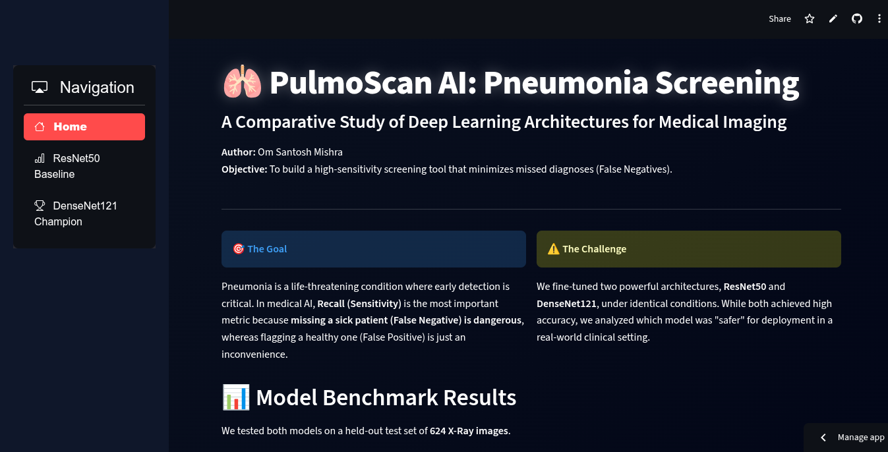
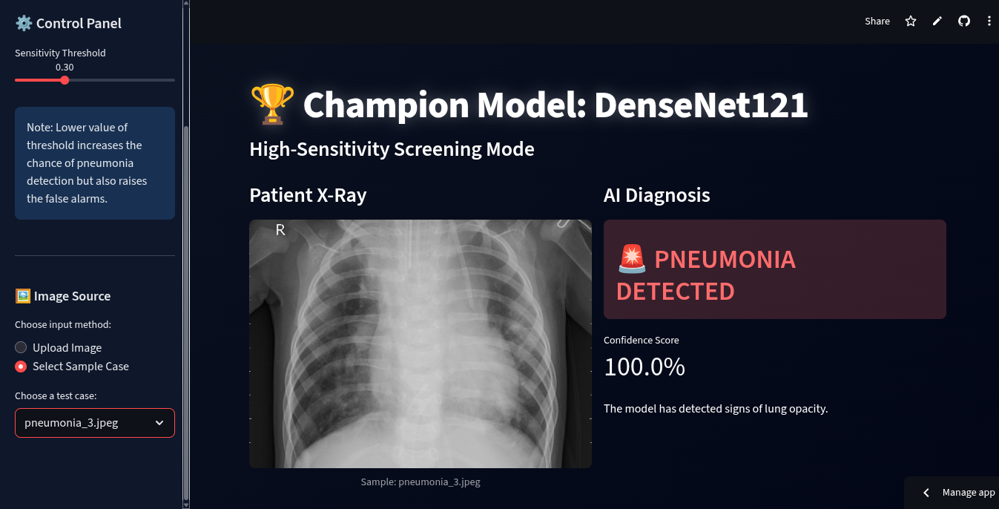
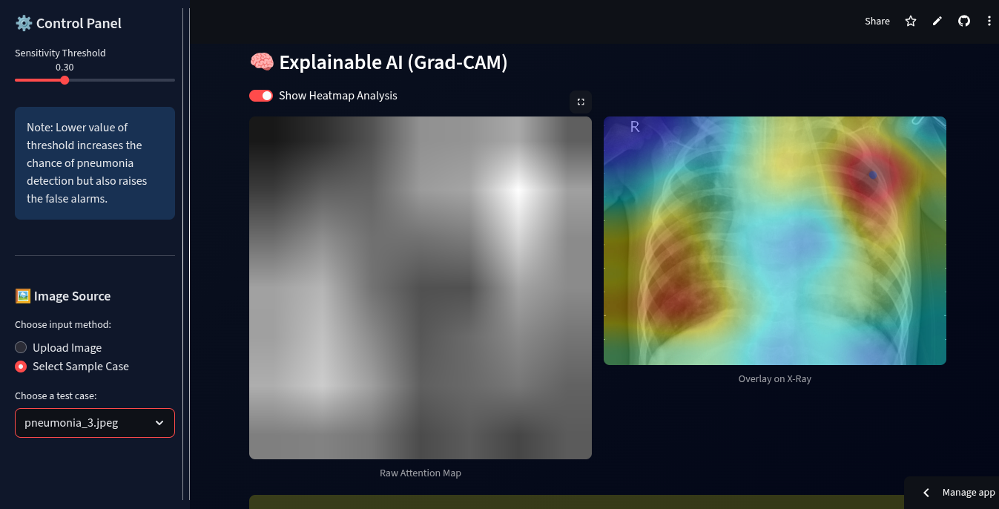

# 🫁 PulmoScan AI: High-Sensitivity Pneumonia Screening

[](https://www.python.org/)
[](https://pytorch.org/)
[](https://streamlit.io/)

> **A Deep Learning-powered medical screening tool designed to minimize False Negatives in pneumonia detection.**
> Benchmarking **ResNet50 (Baseline)** vs. **DenseNet121 (Champion)** on Chest X-Rays.

---
**Live Demo:** [pulmoscan-ai-ayushpremrocks.streamlit.app](https://pulmoscan-ai-ayushpremrocks.streamlit.app)
---
## 📸 Project Demo





---

## 🎯 The Problem
In medical diagnostics, **Sensitivity (Recall)** is the most critical metric.
* **False Positive:** A healthy patient is flagged for further testing (Inconvenient but safe).
* **False Negative:** A sick patient is sent home (Dangerous).

Most standard models prioritize accuracy, often missing subtle cases. **PulmoScan AI** was engineered to maximize Recall, ensuring that potential pneumonia cases are not missed.

---

## 🔬 Model Performance
Both models were fine-tuned from ImageNet weights and tested on the same held-out set of **624 X-rays** (390 pneumonia, 234 normal).

| Model | Role | Threshold | Sensitivity (Recall) | Specificity | Precision | ROC-AUC |
| :--- | :--- | :---: | :---: | :---: | :---: | :---: |
| **ResNet50** | Baseline | 0.70 | 97.0% | 74% | 86% | 0.964 |
| **DenseNet121** | **Champion (screening)** | 0.30 | **99.7%** | 51% | 77% | 0.961 |

> **Key result:** at its screening threshold, DenseNet121 caught **389 of 390** pneumonia cases (about 11 more than ResNet50).
> The cost is false alarms: it flags about half of healthy patients (~115 of 234), compared with ~61 for ResNet50.
> Both models rank X-rays about equally well (similar ROC-AUC), so the difference comes mostly from the chosen threshold.
> The app's **Model evaluation** page compares them fairly at matched sensitivity.

**Caveat:** the thresholds were tuned while looking at the test set, so these numbers are slightly optimistic.

---

## 🚀 Key Features
* **Multipage Streamlit app** with an Overview, one page per model, a side-by-side **Compare** page and a **Model evaluation** page.
* **Explainable AI (Grad-CAM)** for *both* models, showing which lung regions drive a pneumonia prediction.
* **Adjustable decision threshold** per model, defaulting to each model's tuned value (0.30 for DenseNet121, 0.70 for ResNet50).
* **Model evaluation dashboard:** confusion matrix, sensitivity/specificity/precision at any threshold, ROC curves, and a matched-sensitivity comparison (needs `scripts/evaluate.py`, see below).
* **Input checks:** warns when an upload doesn't look like a chest X-ray (colour image, odd shape, too small) and handles unreadable files.
* **Sample gallery:** 20 test-set X-rays (10 normal, 10 pneumonia) for quick demos.
* **Cached inference:** models load once, and predictions and heatmaps are cached per image.

---

## 🛠️ Tech Stack
* **Deep Learning:** PyTorch, Torchvision
* **Web Framework:** Streamlit (`st.navigation`), Altair charts
* **Image Processing:** OpenCV (headless), Pillow
* **Explainability:** Grad-CAM (custom implementation)

---

## 💻 Installation & Setup

### 1. Clone the repository
```
git clone https://github.com/ayushpremrocks/PulmoScan-AI.git
cd PulmoScan-AI
```
### 2. Create a virtual environment and install dependencies
```
python -m venv .venv
.venv\Scripts\activate          # Windows  (macOS/Linux: source .venv/bin/activate)
python -m pip install -r requirements.txt
```
### 3. Run the app
```
python -m streamlit run Home.py
```
Using `python -m ...` also works on machines where Windows Application Control blocks the `pip.exe` / `streamlit.exe` launchers.

### 4. (Optional) Enable the Model evaluation page
Download the [Chest X-Ray Images (Pneumonia)](https://www.kaggle.com/datasets/paultimothymooney/chest-xray-pneumonia) dataset, then score its test split:
```
python scripts/evaluate.py --data-dir path/to/chest_xray/test
```
This writes `evaluation/test_predictions.csv`, which the evaluation page reads.

## 📂 Project Structure
```
PulmoScan-AI/
├── Home.py                 # Entry point: page config, styles, navigation
├── app_pages/
│   ├── overview.py         # Project summary and benchmark results
│   ├── densenet121.py      # Champion model analysis + Grad-CAM
│   ├── resnet50.py         # Baseline model analysis + Grad-CAM
│   ├── compare.py          # Both models on the same X-ray
│   └── evaluation.py       # Confusion matrix, ROC, matched-sensitivity comparison
├── config.py               # Paths, model settings, reported metrics (single source of truth)
├── inference.py            # Model loading, preprocessing, prediction, Grad-CAM (no Streamlit)
├── metrics.py              # Sensitivity/specificity/ROC/AUC helpers
├── ui.py                   # Shared Streamlit components
├── scripts/evaluate.py     # Batch-score a labelled test folder → CSV
├── styles/styles.css       # Custom dark theme
├── .streamlit/config.toml  # Streamlit theme and server settings
├── pneumonia_densenet_final.pth
├── pneumonia_resnet_final.pth
└── test_samples/           # 10 normal + 10 pneumonia demo X-rays
```

## 🧠 What I Learned

### 1. Architectural Insights (ResNet vs. DenseNet)
* **Feature Reuse vs. Residuals:** While ResNet50 uses skip connections to solve the vanishing gradient problem, I found that **DenseNet121's feature concatenation** mechanism was superior for medical imaging.
* **Texture Recognition:** Pneumonia often manifests as subtle, hazy textures rather than distinct shapes. DenseNet preserves high-frequency details from earlier layers by passing them directly to deeper layers, allowing the model to distinguish between "noise" and "pathological opacity" more effectively than ResNet.

### 2. Mastering Explainable AI (Grad-CAM)
* **The Resolution Challenge:** A major hurdle was visualizing the "Attention Map" correctly. The final convolutional layers of DenseNet produce very small feature maps ($7 \times 7$ pixels). When naively upscaled, this resulted in blocky, uninformative heatmaps.
* **The Solution:**
    1.  **Layer Targeting:** I switched from targeting the specific `denselayer16` (which only held partial features) to the `norm5` layer (which holds the aggregated features of the entire dense block).
    2.  **Interpolation:** Implementing **Bicubic Interpolation** during the upscale process transformed the blocky artifacts into smooth, organic heatmaps that accurately mimic the diffuse nature of lung infections.

### 3. Medical AI Metrics & Trade-offs
* **The Cost of a Miss:** I learned that in healthcare, **Accuracy is a vanity metric.** A model with 95% accuracy is useless if it misses the 5% of sick patients.
* **Optimizing for Recall:** I deliberately tuned the decision threshold and architecture choice to maximize **Recall (Sensitivity)**. Missing at most a handful of cases on the test set (1 of 390) was the primary success criterion, even though it meant accepting many more false positives (acceptable for a first-line screening tool, as long as that cost is reported honestly).

### 4. Full-Stack ML Engineering
* **Latency Optimization:** Deploying large PyTorch models on a CPU-based cloud environment introduced significant lag. I solved this by implementing Streamlit's `@st.cache_resource` to load the 30MB+ models into memory only once, reducing inference time from **~5s to <1s**.
* **Dependency Management:** I navigated the "Headless Server" constraints by swapping standard OpenCV for `opencv-python-headless`, preventing runtime crashes on the Streamlit Cloud container.

## 🤝 Let's Connect

**Ayush Prem** *Machine Learning Enthusiast | Data Scientist*

If you have any questions about this project, want to discuss the architecture, or are interested in collaboration, feel free to reach out!

* 📧 **Email:** [ayushpremrocks@gmail.com](mailto:ayushpremrocks@gmail.com)
* 👔 **LinkedIn:** [Ayush Prem](https://www.linkedin.com/in/ayushpremrocks)
* 🐙 **GitHub:** [ayushpremrocks](https://github.com/ayushpremrocks)
  
### **Disclaimer:** This tool is for educational and research purposes only. It is not a substitute for professional medical diagnosis.
